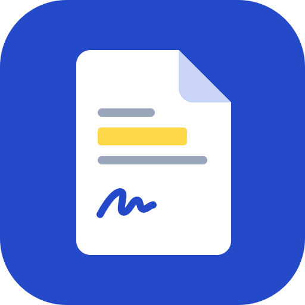
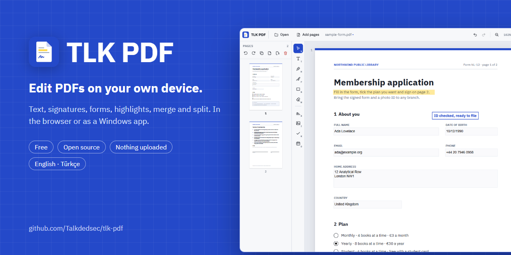
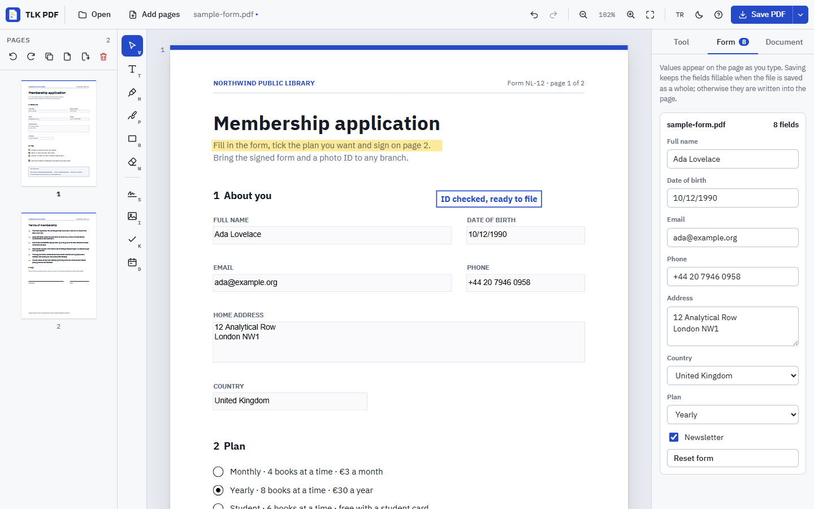
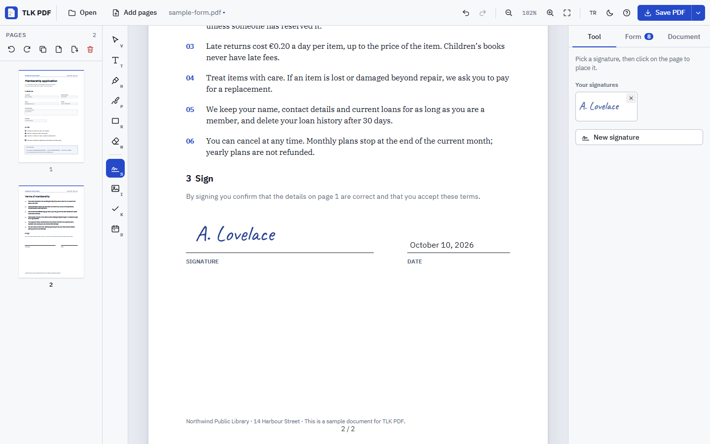

<div align="center">



# TLK PDF

**Edit PDFs on your own device. Free, open source, nothing is uploaded.**

[**Open the app ↗**](https://talkdedsec.github.io/tlk-pdf/) · [Download for Windows](https://github.com/Talkdedsec/tlk-pdf/releases/latest) · [Türkçe](README.tr.md)

[](https://github.com/Talkdedsec/tlk-pdf/actions/workflows/ci.yml)
[](https://github.com/Talkdedsec/tlk-pdf/actions/workflows/pages.yml)
[](https://github.com/Talkdedsec/tlk-pdf/releases/latest)
[](LICENSE)



</div>

TLK PDF is a PDF editor for the everyday jobs: fill in a form, sign it, add a note, highlight a line, cover something with white, put pages in a different order, merge two files or split one apart. It reads and writes real PDFs, so text you add stays text you can search and copy, and form fields stay fillable whenever possible.

Everything happens on your device: in the browser through GitHub Pages (installable, works offline), or as a Windows program. There is no account, no upload, no watermark and no page limit. The interface is in **English and Turkish**.



## Start in 10 seconds

1. [Open TLK PDF](https://talkdedsec.github.io/tlk-pdf/), or the Windows app.
2. Drop a PDF on the page, or press **Try the sample form**.
3. Pick a tool on the left, work on the page, then press **Save PDF**.

## What you can do

| Area | Details |
| --- | --- |
| Text | Click anywhere and type. Sans, serif or mono, bold, any size and colour; several lines; every Latin, Turkish and Cyrillic letter. Double-click to edit later |
| Forms | Every text field, tick box, option and list of a fillable PDF in one panel; values show on the page as you type |
| Signatures | Draw with a mouse, pen or finger, type your name in a handwriting font, or use a photo of your signature (the paper background is removed). Saved signatures stay on this device |
| Marking | Highlighter that multiplies like a real one, rectangles with or without fill, freehand pen, ticks, crosses and dots, today’s date in one click |
| White-out | Cover anything with white or any colour |
| Images | Place a picture on a page, or paste one with <kbd>Ctrl</kbd>+<kbd>V</kbd> |
| Pages | Thumbnails with multi-select; drag to reorder; rotate, duplicate, delete, insert blank pages |
| Merge | Add more PDFs or images to the open document; images become pages |
| Split | Save the selected pages as a new PDF, every page as its own PDF in a ZIP, or every page as a PNG |
| Document | Page numbers in six positions and five formats, a text watermark, title, author, subject and keywords |
| Editing | Select, move, resize, nudge with arrow keys, duplicate, bring to front; undo and redo for everything |
| Protected files | Password-protected PDFs open after you type the password |



## How saving works

- **One file, pages in their original order** (you may delete some): TLK PDF edits that file. Links, bookmarks and attachments stay, and form fields stay fillable.
- **Files merged, pages reordered or added**: a new PDF is built from the pages. Form fields are written into the page with the values you typed, so they look the same everywhere.
- **Encrypted files** that cannot be rewritten are saved with their pages as images (the app tells you when this happens).
- Added text is real text in the IBM Plex fonts, embedded as a subset, so it can be searched and copied.

## Windows app

Download from the [latest release](https://github.com/Talkdedsec/tlk-pdf/releases/latest):

- `tlk-pdf-<version>-portable.exe`: a single file, no installation. Double-click to run.
- `tlk-pdf-<version>-setup.exe`: installs for the current user, with Start menu and desktop shortcuts, **Open with → TLK PDF** for PDF files, and an uninstaller.

It is the same app as the website, works completely offline and saves through the normal Windows Save dialog. Once a day it checks GitHub for a newer release and tells you; nothing else leaves your computer.

The executables are not code-signed, so Windows SmartScreen may show "Windows protected your PC". Choose **More info → Run anyway**, or check the file against `SHA256SUMS.txt` in the release first.

## Shortcuts

| Keys | Action |
| --- | --- |
| <kbd>Ctrl</kbd> <kbd>O</kbd> | Open files |
| <kbd>Ctrl</kbd> <kbd>S</kbd> | Save PDF |
| <kbd>Ctrl</kbd> <kbd>Z</kbd> / <kbd>Ctrl</kbd> <kbd>Y</kbd> | Undo / redo |
| <kbd>V</kbd> <kbd>T</kbd> <kbd>H</kbd> <kbd>P</kbd> <kbd>R</kbd> <kbd>W</kbd> | Select, text, highlight, pen, rectangle, white-out |
| <kbd>S</kbd> <kbd>I</kbd> <kbd>K</kbd> <kbd>D</kbd> | Signature, image, tick, date |
| <kbd>Delete</kbd> | Delete the selected item, or the selected pages when the page list has focus |
| Arrow keys | Move the selected item by 1 pt (<kbd>Shift</kbd>: 10 pt) |
| <kbd>Ctrl</kbd> <kbd>D</kbd> | Duplicate the selected item |
| <kbd>Ctrl</kbd> <kbd>+</kbd> / <kbd>Ctrl</kbd> <kbd>−</kbd> / <kbd>Ctrl</kbd> <kbd>0</kbd> | Zoom in, zoom out, actual size (also <kbd>Ctrl</kbd> + mouse wheel) |
| <kbd>Esc</kbd> | Finish text, clear the selection, back to Select |

## Good to know

- TLK PDF adds to a page and covers parts of it; it does not rewrite text that is already in the PDF.
- **White-out hides, it does not delete.** The covered content is still in the file underneath. Do not use it to remove confidential information.
- A drawn or typed signature is a picture of your signature, not a certificate-based digital signature.
- Scanned pages stay pictures; there is no text recognition (OCR).
- XFA forms (an old Adobe-only format) are not supported.

## Privacy

Files are read with the browser’s File API and processed on your device by [pdf.js](https://github.com/mozilla/pdf.js) and [pdf-lib](https://github.com/Hopding/pdf-lib). Nothing is uploaded; there are no analytics and no cookies. Saved signatures, the language and the theme live in your browser’s local storage. The website is hosted on GitHub Pages, which may keep ordinary access logs.

## Development

Node.js 24 is only needed to work on the project; the web app has no build step.

```sh
git clone https://github.com/Talkdedsec/tlk-pdf.git
cd tlk-pdf
npm ci
npm run serve          # http://127.0.0.1:5180
npm test               # end-to-end checks in Edge or Chrome
npm run test:desktop   # the desktop app with a PDF on the command line
npm start              # desktop app
npm run dist           # Windows portable + installer into release/
npm run assets         # icons, screenshots and the social image
npm run vendor         # copy pdf.js, pdf-lib, fontkit, fflate and fonts into web/
npm run sample         # rebuild the sample form
```

```
web/        the app: HTML, CSS, JavaScript modules, vendored libraries and fonts
desktop/    Electron shell that serves web/ offline and adds Open with and Save
scripts/    local server, browser tests, asset renderer, vendoring, sample form
```

The browser scripts use an installed Edge or Chrome; set `BROWSER_PATH` to use another Chromium-based browser. Bugs and ideas are welcome in [issues](https://github.com/Talkdedsec/tlk-pdf/issues); see [CONTRIBUTING.md](CONTRIBUTING.md).

## Credits

- [pdf.js](https://github.com/mozilla/pdf.js) by Mozilla (Apache-2.0): rendering and form fields
- [pdf-lib](https://github.com/Hopding/pdf-lib) by Andrew Dillon (MIT): writing PDFs
- [@pdf-lib/fontkit](https://github.com/Hopding/fontkit) (MIT): embedding fonts
- [fflate](https://github.com/101arrowz/fflate) by Arjun Barrett (MIT): ZIP files
- [IBM Plex](https://github.com/IBM/plex) Sans, Serif and Mono, and [Caveat](https://github.com/googlefonts/caveat), under the SIL Open Font License 1.1 (licence texts in [`web/fonts`](web/fonts))

## License

[MIT](LICENSE) for the code. The vendored libraries and fonts keep their own licences.
