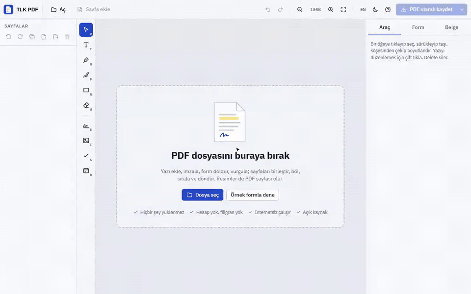

<div align="center">


# TLK PDF

**PDF'leri kendi cihazında düzenle. Ücretsiz, açık kaynak, hiçbir şey yüklenmez.**

[**Uygulamayı aç ↗**](https://talkdedsec.github.io/tlk-pdf/) · [Windows için indir](https://github.com/Talkdedsec/tlk-pdf/releases/latest) · [English](README.md)

[](https://github.com/Talkdedsec/tlk-pdf/actions/workflows/ci.yml)
[](https://github.com/Talkdedsec/tlk-pdf/actions/workflows/pages.yml)
[](https://github.com/Talkdedsec/tlk-pdf/releases/latest)
[](LICENSE)


</div>

TLK PDF günlük PDF işleri için bir düzenleyici: form doldur, imzala, not ekle, satır vurgula, bir yeri beyazla kapat, sayfaların sırasını değiştir, iki dosyayı birleştir ya da birini parçala. Gerçek PDF okur ve yazar; eklediğin yazı aranabilir, kopyalanabilir yazı olarak kalır, form alanları da mümkün olduğunda doldurulabilir kalır.

Her şey kendi cihazında olur: tarayıcıda GitHub Pages üzerinden (kurulabilir, internetsiz çalışır) ya da Windows programı olarak. Hesap, yükleme, filigran ve sayfa sınırı yok. Arayüz **Türkçe ve İngilizce**.



<sub>[Video olarak](docs/demo-tr.mp4) · [koyu tema](docs/screenshot-dark.png)</sub>

## 10 saniyede başla

1. [TLK PDF'i aç](https://talkdedsec.github.io/tlk-pdf/) ya da Windows uygulamasını çalıştır.
2. Bir PDF'i sayfaya bırak ya da **Örnek formla dene**'ye bas.
3. Soldan bir araç seç, sayfada çalış, sonra **PDF olarak kaydet**'e bas.

## Neler yapabilirsin

| Alan | Ayrıntı |
| --- | --- |
| Yazı | İstediğin yere tıkla ve yaz. Sans, serif ya da mono, kalın, her boyut ve renk; birden çok satır; tüm Latin, Türkçe ve Kiril harfleri. Sonradan düzenlemek için çift tıkla |
| Formlar | Doldurulabilir PDF'teki tüm yazı alanları, onay kutuları, seçenekler ve listeler tek panelde; yazdıkların sayfada anında görünür |
| İmza | Fare, kalem ya da parmakla çiz, adını el yazısı fontuyla yaz ya da imzanın fotoğrafını kullan (kâğıt arka planı silinir). Kayıtlı imzalar bu cihazda kalır |
| İşaretleme | Gerçek fosforlu kalem gibi karışan vurgulayıcı, dolgulu ya da dolgusuz dikdörtgen, serbest kalem, tik, çarpı ve nokta, tek tıkla bugünün tarihi |
| Beyazla kapatma | Herhangi bir yeri beyazla ya da istediğin renkle kapat |
| Resim | Sayfaya resim yerleştir ya da <kbd>Ctrl</kbd>+<kbd>V</kbd> ile yapıştır |
| Sayfalar | Çoklu seçimli küçük resimler; sürükleyerek sırala; döndür, çoğalt, sil, boş sayfa ekle |
| Birleştirme | Açık belgeye başka PDF'ler ya da resimler ekle; resimler sayfa olur |
| Bölme | Seçili sayfaları yeni PDF olarak, her sayfayı ayrı PDF olarak ZIP içinde ya da her sayfayı PNG olarak kaydet |
| Belge | Altı konum ve beş biçimde sayfa numarası, yazılı filigran, başlık, yazar, konu ve anahtar kelimeler |
| Düzenleme | Seç, taşı, boyutlandır, ok tuşlarıyla kaydır, çoğalt, en öne getir; her şey için geri al ve yinele |
| Korumalı dosyalar | Parolalı PDF'ler parolayı yazınca açılır |


## Kaydetme nasıl çalışır

- **Tek dosya, sayfalar ilk sırasında** (bazılarını silmiş olabilirsin): TLK PDF o dosyayı düzenler. Bağlantılar, yer imleri ve ekler kalır, form alanları doldurulabilir kalır.
- **Dosyalar birleştirildiyse, sayfalar yeniden sıralandıysa ya da eklendiyse**: sayfalardan yeni bir PDF kurulur. Form alanları yazdığın değerlerle sayfaya işlenir, böylece her yerde aynı görünür.
- Yeniden yazılamayan **şifreli dosyalar** sayfaları resim olarak kaydedilir (uygulama bunu sana söyler).
- Eklenen yazı, alt küme olarak gömülen IBM Plex fontlarıyla gerçek yazıdır; aranabilir ve kopyalanabilir.

## Windows uygulaması

[Son sürümden](https://github.com/Talkdedsec/tlk-pdf/releases/latest) indir:

- `tlk-pdf-<sürüm>-portable.exe`: tek dosya, kurulum yok. Çift tıklayıp çalıştır.
- `tlk-pdf-<sürüm>-setup.exe`: geçerli kullanıcı için kurar; Başlat menüsü ve masaüstü kısayolu, PDF dosyalarında **Birlikte aç → TLK PDF** ve kaldırıcı ile.

Web sitesindekiyle aynı uygulamadır, tamamen internetsiz çalışır ve Windows'un normal Kaydet penceresiyle kaydeder. Günde bir kez GitHub'da yeni sürüm olup olmadığına bakar ve sana söyler; bunun dışında bilgisayarından hiçbir şey çıkmaz.

Dosyalar kod imzalı değildir; Windows SmartScreen "Windows bilgisayarınızı korudu" diyebilir. **Ek bilgi → Yine de çalıştır**'ı seç ya da önce dosyayı sürümdeki `SHA256SUMS.txt` ile karşılaştır.

## Kısayollar

| Tuşlar | İşlem |
| --- | --- |
| <kbd>Ctrl</kbd> <kbd>O</kbd> | Dosya aç |
| <kbd>Ctrl</kbd> <kbd>S</kbd> | PDF olarak kaydet |
| <kbd>Ctrl</kbd> <kbd>Z</kbd> / <kbd>Ctrl</kbd> <kbd>Y</kbd> | Geri al / yinele |
| <kbd>V</kbd> <kbd>T</kbd> <kbd>H</kbd> <kbd>P</kbd> <kbd>R</kbd> <kbd>W</kbd> | Seç, yazı, vurgula, kalem, dikdörtgen, beyazla kapat |
| <kbd>S</kbd> <kbd>I</kbd> <kbd>K</kbd> <kbd>D</kbd> | İmza, resim, tik, tarih |
| <kbd>Delete</kbd> | Seçili öğeyi ya da sayfa listesi odaktayken seçili sayfaları sil |
| Ok tuşları | Seçili öğeyi 1 pt kaydır (<kbd>Shift</kbd>: 10 pt) |
| <kbd>Ctrl</kbd> <kbd>D</kbd> | Seçili öğeyi çoğalt |
| <kbd>Ctrl</kbd> <kbd>+</kbd> / <kbd>Ctrl</kbd> <kbd>−</kbd> / <kbd>Ctrl</kbd> <kbd>0</kbd> | Yakınlaştır, uzaklaştır, gerçek boyut (<kbd>Ctrl</kbd> + fare tekerleği de olur) |
| <kbd>Esc</kbd> | Yazıyı bitir, seçimi kaldır, Seç aracına dön |

## Bilmekte fayda var

- TLK PDF sayfaya ekler ve sayfanın bir kısmını kapatır; PDF'te zaten olan yazıyı yeniden yazmaz.
- **Beyazla kapatma gizler, silmez.** Kapatılan içerik dosyada altta durur. Gizli bilgiyi kaldırmak için kullanma.
- Çizilen ya da yazılan imza, imzanın bir resmidir; sertifikalı dijital imza değildir.
- Taranmış sayfalar resim olarak kalır; yazı tanıma (OCR) yok.
- XFA formları (yalnızca Adobe'nin eski biçimi) desteklenmez.

## Gizlilik

Dosyalar tarayıcının File API'siyle okunur ve [pdf.js](https://github.com/mozilla/pdf.js) ile [pdf-lib](https://github.com/Hopding/pdf-lib) tarafından cihazında işlenir. Hiçbir şey yüklenmez; analiz ve çerez yok. Kayıtlı imzalar, dil ve tema tarayıcının yerel depolamasında durur. Web sitesi GitHub Pages'te barınır; GitHub olağan erişim kayıtları tutabilir.

## Geliştirme

Node.js 24 yalnızca proje üzerinde çalışmak için gerekir; web uygulamasının derleme adımı yoktur.

```sh
git clone https://github.com/Talkdedsec/tlk-pdf.git
cd tlk-pdf
npm ci
npm run serve          # http://127.0.0.1:5180
npm test               # Edge ya da Chrome'da uçtan uca testler
npm run test:desktop   # komut satırından PDF verilen masaüstü uygulaması
npm start              # masaüstü uygulaması
npm run dist           # release/ içine Windows portable + kurulum
npm run assets         # ikonlar, ekran görüntüleri ve sosyal görsel
npm run demo           # README demolarını kaydet (ffmpeg gerekir)
npm run vendor         # pdf.js, pdf-lib, fontkit, fflate ve fontları web/'e kopyala
npm run sample         # örnek formu yeniden üret
```

```
web/        uygulama: HTML, CSS, JavaScript modülleri, kopyalanmış kütüphaneler ve fontlar
desktop/    web/'i internetsiz sunan, Birlikte aç ve Kaydet ekleyen Electron kabuğu
scripts/    yerel sunucu, tarayıcı testleri, görsel üretici, kütüphane kopyalama, örnek form
```

Tarayıcı betikleri kurulu Edge ya da Chrome kullanır; başka bir Chromium tabanlı tarayıcı için `BROWSER_PATH` ver. Hatalar ve öneriler [issue'larda](https://github.com/Talkdedsec/tlk-pdf/issues) memnuniyetle karşılanır; bkz. [CONTRIBUTING.md](CONTRIBUTING.md).

## Teşekkür

- Mozilla'dan [pdf.js](https://github.com/mozilla/pdf.js) (Apache-2.0): çizim ve form alanları
- Andrew Dillon'dan [pdf-lib](https://github.com/Hopding/pdf-lib) (MIT): PDF yazma
- [@pdf-lib/fontkit](https://github.com/Hopding/fontkit) (MIT): font gömme
- Arjun Barrett'tan [fflate](https://github.com/101arrowz/fflate) (MIT): ZIP dosyaları
- [IBM Plex](https://github.com/IBM/plex) Sans, Serif ve Mono ile [Caveat](https://github.com/googlefonts/caveat), SIL Open Font License 1.1 ile (lisans metinleri [`web/fonts`](web/fonts) içinde)

## Lisans

Kod için [MIT](LICENSE). Kopyalanan kütüphaneler ve fontlar kendi lisanslarını korur.
